# Orange Data Mining

Orange es un programa informático para realizar minería de datos y análisis predictivo desarrollado en la facultad de informática de la Universidad de Liubliana. Consta de una serie de componentes desarrollados en C++ que implementan algoritmos de minería de datos, así como operaciones de preprocesamiento y representación gráfica de datos.

Los componentes de Orange pueden ser manipulados desde programas desarrollados en Python o a través de un entorno gráfico. Se distribuye bajo licencia GPL.

Su sitio oficial esta disponible en la liga <a href="https://orangedatamining.com/">orangedatamining.com</a>

## Catálogo de Widgets

La aplicación permite realizar tareas de minerías de datos a través de un entorno gráfico y un catalogo de widgets *drag & drop*. 

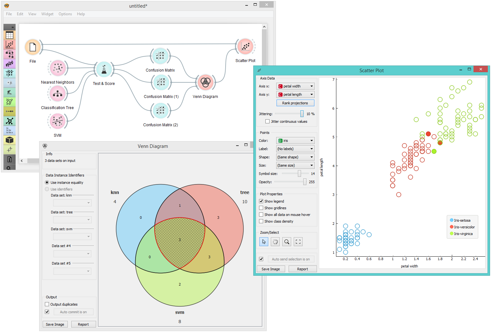

Los widgets de Orange son componentes básicos de los flujos de trabajo de análisis de datos que se ensamblan en el entorno de programación visual de Orange. Los widgets se agrupan en clases según su función. Un flujo de trabajo típico puede combinar widgets para la entrada y el filtrado de datos, la visualización y la minería de datos predictiva. Aquí puede consultar la lista de todos los widgets disponibles en Orange.

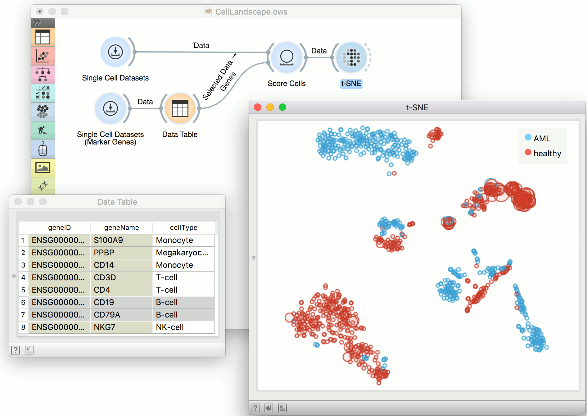

## Flujos de trabajo

Orange incluye una amplia variedad de plantillas de flujo de trabajo diseñadas para ayudarte a familiarizarte con la aplicación. Selecciona Plantillas en la pantalla de bienvenida para explorarlas.

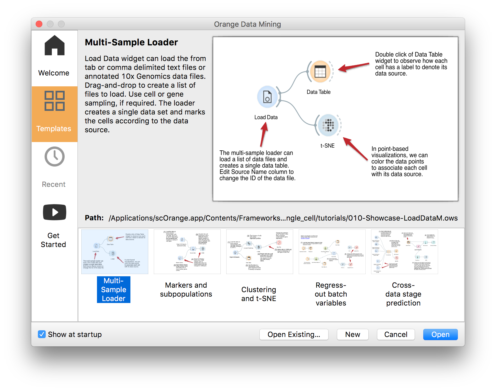

## Tutoriales

Orange tiene una canal en Youtube para aprender sobre el desarrollo de flujos de trabajo de Orange, la carga de datos, los algoritmos básicos de aprendizaje automático y las visualizaciones interactivas. Para acceder al canal puedes dar <a href="https://www.youtube.com/channel/UClKKWBe2SCAEyv7ZNGhIe4g" target="_blank">clic aquí</a>.

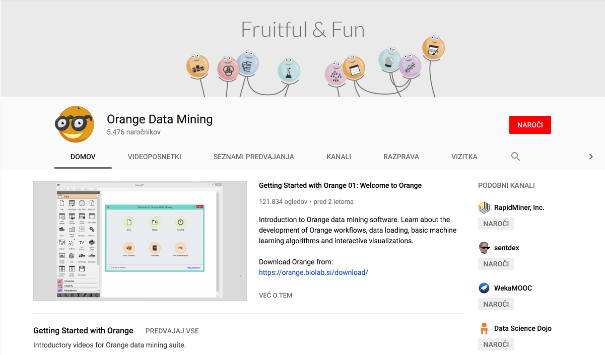

## Instalación

1. Una vez descargado el archivo de instalación, hay que ejecutarlo (Windows) y presionar *siguiente*.

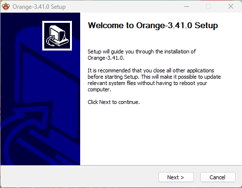

2. Aceptar el Acuerdo de Licencia

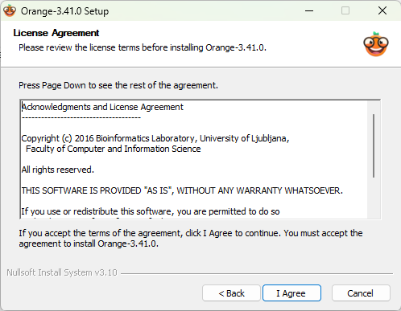

3. Indicar el o los usuarios que utilizarán la aplicación.

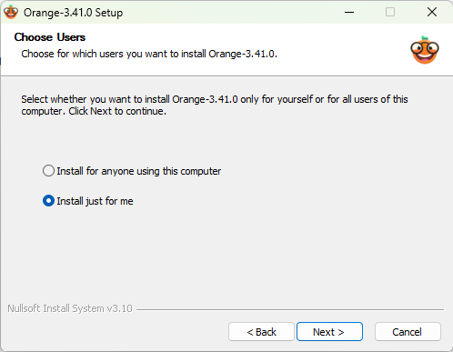

4. Seleccionar los componentes que se instalarán (Se recomienda mantener la selección por defecto).

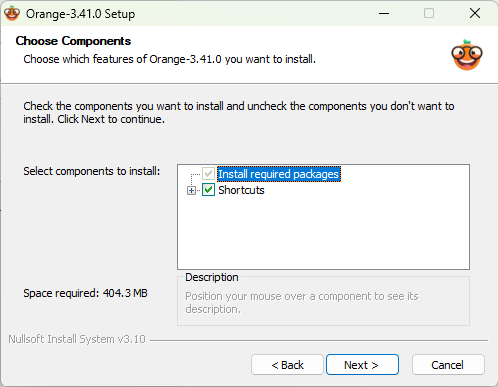

5. Escoger la carpeta de instalación (Se recomienda mantener la ubicación por defecto). 

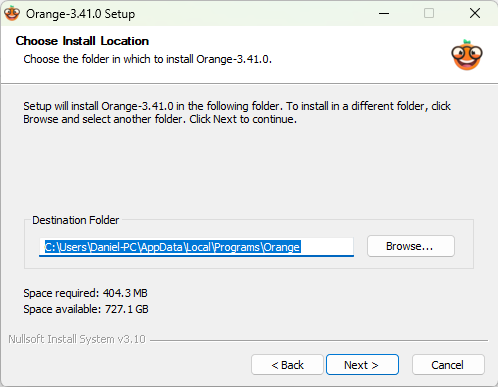

6. Seleccionar el nombre de la aplicación en el Menú de inicio (Se recomienda mantener la denominación por defecto) y finalmente, presionar *Instalar*.

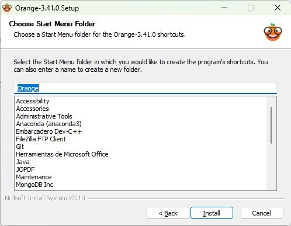

7. Una vez completada la instalación, presionar *siguiente*.

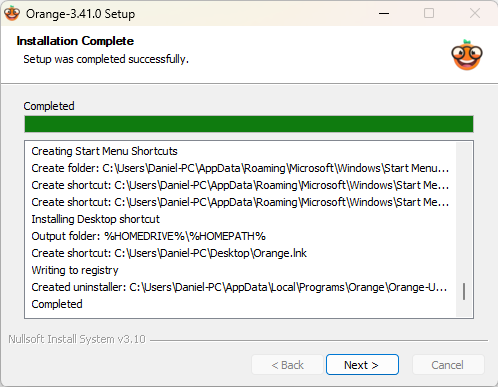

8. Finalmente, presionar *Terminar* para cerrar el asistente (Mantener seleccionado *Comenzar Orange* si se desea abrir ya la aplicación).

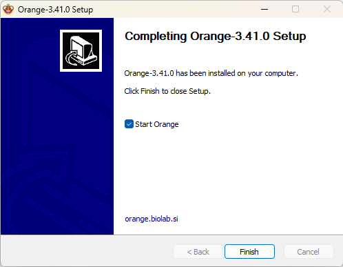

